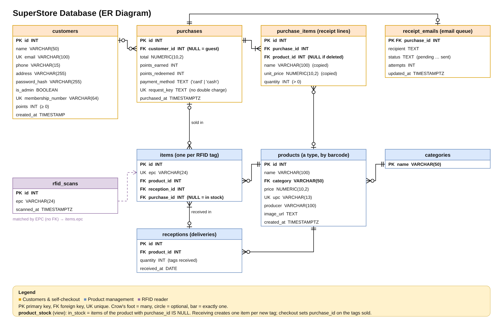

# SuperStore

A smart-store simulation where sensors, scanners and single-board computers connect the customer experience to store management.

Final project for **Internet of Things (420-521-VA)**, Vanier College.

---

## Overview

SuperStore is built in three phases, each adding to the last.

| Phase | Scope | Status |
|---|---|---|
| **1. Customer registration** | Sign-up and login with LED feedback | Done |
| **2. IoT dashboard** | Fridge sensors over MQTT, thresholds, email alerts, fan control | Done |
| **3. Store operations** | Product management, inventory, barcode/RFID scanning, self-checkout, loyalty points | In progress |

The application has two sides:

- **Management** (admins): fridge monitoring, products and inventory.
- **Customers**: account, self-checkout station, points and receipts.

## Features

**Phase 1: Registration**
- Sign-up and login with server-side validation and hashed passwords
- Blue LED on success, red LED on failure

**Phase 2: Fridge monitoring**
- Two ESP32 + DHT11 sensors publish temperature and humidity over MQTT (`Frig1`, `Frig2`)
- Live dashboard with four gauges, fan status and over-temperature alerts
- Per-fridge temperature thresholds stored in the database
- Email alert when a fridge is too warm; replying **YES** turns the fan (DC motor) on

**Phase 3: Store operations**
- Product catalogue with UPC (barcode) and EPC (RFID tag)
- Each product is defined once and received many times; stock is computed, never stored
- Inventory with low-stock flags; barcode scanner and RFID reader support
- Self-checkout: scan all items at once, membership card, payment simulation, points, emailed receipt (email requires the receipt worker)

## Tech Stack

| Layer | Technology |
|---|---|
| Backend | PHP 8, MVC (no framework) |
| Database | PostgreSQL on Supabase, through its REST API |
| Frontend | HTML, CSS, JavaScript |
| Hardware control | Python 3 (`gpiozero`, `paho-mqtt`, `pyserial`) on Raspberry Pi 5 |
| Messaging | MQTT (Mosquitto) |
| Microcontrollers | ESP32 + DHT11 (Arduino C++) |
| Scanners | USB barcode scanner, Chafon CF600 UHF RFID reader |

## Architecture

```
ESP32 + DHT11 ──MQTT──▶ Mosquitto ──▶ monitor.py ──HTTP──▶ ┐
RFID reader ───────────▶ reader script ────HTTP──────────▶ │ PHP app (Pi) ──REST──▶ Supabase
Barcode scanner ──▶ browser (types like a keyboard) ─────▶ │
                         fan.py ◀── GET /api/fan ───────── ┘
                           └──GPIO──▶ motor driver ──▶ DC motor
```

Devices never talk to the database directly: every device and page goes through the PHP API, and only the models talk to Supabase.

**Request flow:** `public/index.php` matches the route and calls a controller → the controller validates the input and calls a model → the model queries Supabase → the controller renders a view or returns JSON.

## Project Structure

```
SuperStore/
├── app/
│   ├── controllers/   # Auth, Threshold, ReadingApi, FanApi, Product, ScanApi
│   ├── models/        # Customer, Fridge, Reading, FanState, Alert, Product, Reception, Scan
│   ├── services/      # SupaClient (Supabase requests)
│   └── views/         # login, signup, dashboard, thresholds
├── config/
│   ├── db.php         # loads .env, Supabase REST helper
│   └── db.sql         # database schema, one section per phase
├── docs/              # database design, ER diagram, API reference
├── public/            # index.php (routes) and assets
└── scripts/           # Raspberry Pi and ESP32 programs
```

## Getting Started

### 1. Configuration

Copy `.env.example` to `.env` and fill in:

| Key | Description |
|---|---|
| `SUPABASE_URL` | Supabase → Project Settings → API |
| `SUPABASE_SECRET_KEY` | Secret key (server only, never commit it) |
| `GMAIL_USER`, `GMAIL_APP_PASSWORD` | Gmail account and app password used to send emails |
| `ALERT_TO` | Address that receives fridge alerts (defaults to `GMAIL_USER`) |

### 2. Database

For a fresh database, run `config/db.sql` in the Supabase SQL Editor. Then apply `config/checkout.sql` and `config/receipt_emails.sql`, in that order. Both are safe to run again on an existing database. Give your account admin access:

```sql
UPDATE customers SET is_admin = TRUE WHERE email = 'you@example.com';
```

### 3. Raspberry Pi

```bash
sudo apt install php-cli php-curl mosquitto python3-gpiozero python3-paho-mqtt python3-dotenv python3-serial
php -S 0.0.0.0:8000 -t public
```

In separate terminals:

```bash
python3 scripts/monitor.py   # fridge readings and email alerts
python3 scripts/fan.py       # fan motor
```

Allow the ESP32 boards to reach the broker (`/etc/mosquitto/conf.d/superstore.conf`), then restart Mosquitto:

```
listener 1883
allow_anonymous true
```

### 4. ESP32 boards

Open `scripts/mqtt.py` (an Arduino sketch) in the Arduino IDE, install **PubSubClient** and **DHT sensor library**, set the Wi-Fi credentials and the Pi's IP address, and flash one board with `TOPIC = "Frig1"` and the other with `"Frig2"`.

### 5. RFID reader

See [CF600 reader setup](docs/RFID.md) for the USB SDK bridge used by the checkout and product pages.

### 6. Checkout demo and receipt email

See the [demonstration guide](docs/Demonstration.md) for the delivery, scan, payment, and receipt workflow. Run `python3 scripts/receipt_worker.py` with the Gmail settings configured to send receipt emails.

## API

| Area | Routes |
|---|---|
| Accounts | `POST /register`, `POST /login`, `GET /logout` |
| Dashboard | `GET /dashboard`, `GET/POST /thresholds`, `GET /api/thresholds` |
| Sensors and fan | `POST /api/readings`, `GET /api/readings/latest`, `GET/POST /api/fan` |
| Products (admin) | `GET /products`, `/products/create`, `/products/edit`, `/products/show`, `/products/receive` |
| Product actions (admin) | `POST /products`, `/products/update`, `/products/delete`, `/receptions` |
| Scanners | `GET /api/products/lookup?code=`, `POST /api/scans`, `GET /api/scans/latest` |

Request and response formats: [`docs/API.md`](docs/API.md).

## Database

Design, relationships and examples: [`docs/ER.md`](docs/ER.md). Editable diagram: [`docs/SuperStore-ERD.drawio`](docs/SuperStore-ERD.drawio).



## Hardware

| Component | Phase | Connection |
|---|---|---|
| Blue / red LEDs | 1 | GPIO 23 / GPIO 18 |
| 2 × ESP32 + DHT11 | 2 | Wi-Fi (MQTT) |
| DC motor + driver | 2 | GPIO 22 (enable), 27 (in 1), 17 (in 2) |
| USB barcode scanner | 3 | USB (keyboard mode) |
| Chafon CF600 RFID reader | 3 | USB (SDK bridge) |

All pins use BCM numbering on a Raspberry Pi 5.

## Team

Group of four, each with a Raspberry Pi 5. Phase 3 is split between management (inventory backend, database, inventory pages) and self-checkout.
