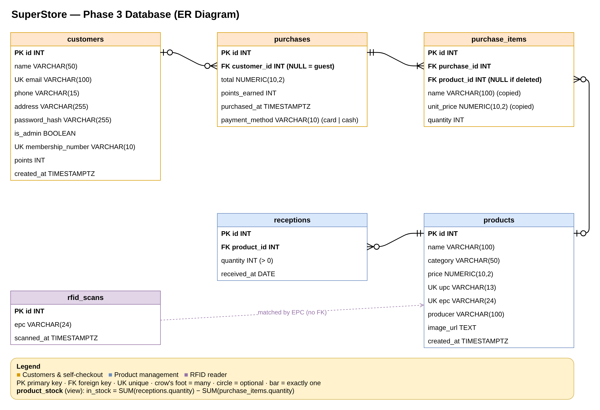

# SuperStore — Phase 3 Database Design



Editable source: [`SuperStore-ERD.drawio`](SuperStore-ERD.drawio) (open it at app.diagrams.net). Full SQL: the Phase 3 section of [`config/db.sql`](../config/db.sql).

## Tables

| Table | One row is… | Used by |
|---|---|---|
| `customers` | One account (customer or admin), with membership number and points | Login, self-checkout |
| `products` | One product, defined once | Management, self-checkout |
| `receptions` | One delivery of a product (quantity + date) | Management |
| `purchases` | One checkout, which is one receipt | Self-checkout |
| `purchase_items` | One line on a receipt (product, quantity, price) | Self-checkout |
| `rfid_scans` | One tag read by the RFID reader | Management, self-checkout |
| `product_stock` *(view)* | A product with its computed `in_stock` | Management |

## Relationships

### Summary

| # | Relationship | Cardinality | Foreign key | On delete |
|---|---|---|---|---|
| 1 | Customer → Purchases | 1 customer : 0..many purchases (a purchase has 0 or 1 customer) | `purchases.customer_id → customers.id` (nullable) | Customer deleted → `SET NULL` |
| 2 | Purchase → Purchase items | 1 purchase : 1..many items | `purchase_items.purchase_id → purchases.id` | Purchase deleted → `CASCADE` |
| 3 | Product → Purchase items | 1 product : 0..many items (an item has 0 or 1 product) | `purchase_items.product_id → products.id` (nullable) | Product deleted → `SET NULL` |
| 4 | Product → Receptions | 1 product : 0..many receptions | `receptions.product_id → products.id` | Product deleted → `CASCADE` |
| 5 | **Customer ↔ Product** | **many : many**, through purchases and purchase items | *(no direct key)* | — |
| 6 | RFID scan ⇢ Product | Matched by value, not a key | `rfid_scans.epc = products.epc` | — |

### 1. Customers and purchases (one-to-many, optional)

A customer can make many purchases. Each purchase belongs to at most one customer.

```sql
customer_id INT REFERENCES customers(id) ON DELETE SET NULL
```

- **Why nullable:** the spec says the membership card is asked for "if applicable". A guest who has no card still checks out, and their purchase gets `customer_id = NULL`, with no points and no receipt email.
- **Why `SET NULL` on delete:** if an account is deleted, its purchases stay in the store's sales history (and still count against stock). They just stop pointing to a person.
- **Used for:** a customer's purchase history and point balance (`customers.points` is the total; `purchases.points_earned` shows what each receipt added).

### 2. Purchases and purchase items (one-to-many, required)

A purchase is the receipt, and purchase items are its lines. A purchase has one or more items, and each item belongs to exactly one purchase.

```sql
purchase_id INT NOT NULL REFERENCES purchases(id) ON DELETE CASCADE
```

- **Why `NOT NULL`:** a receipt line without a receipt means nothing.
- **Why `CASCADE`:** deleting a receipt deletes its lines with it, so no orphan lines are left behind.
- **"At least one item":** a foreign key can't force a minimum, so the `checkout()` database function does it: it refuses an empty list and saves the purchase and its items in the same transaction, so a purchase can never exist without its lines.

### 3. Products and purchase items (one-to-many, optional)

A product appears on many receipt lines. Each line points to at most one product.

```sql
product_id INT REFERENCES products(id) ON DELETE SET NULL
-- plus copies taken at checkout time:
name        VARCHAR(100)  NOT NULL
unit_price  NUMERIC(10,2) NOT NULL
```

- **Why copy `name` and `unit_price`:** a receipt must show what the customer actually paid. If the price changes next week, or the product is renamed, last week's receipt must not change. The line keeps its own copy.
- **Why nullable with `SET NULL`:** an admin can delete a product without deleting anyone's receipts. The line keeps its copied name and price, and `product_id` becomes `NULL`.

### 4. Products and receptions (one-to-many, required)

This is the relationship the spec names: *"each product is defined once, but may be received multiple times."* Every delivery is a new reception row with its own quantity and date. The product row itself never changes when stock arrives.

```sql
product_id  INT  NOT NULL REFERENCES products(id) ON DELETE CASCADE
quantity    INT  NOT NULL CHECK (quantity > 0)
received_at DATE NOT NULL DEFAULT CURRENT_DATE
```

- **Why `CASCADE`:** delivery history only makes sense for a product that exists, so it goes with the product.
- **Stock is computed from this relationship** (and from #3), never stored:

```sql
in_stock = SUM(receptions.quantity) − SUM(purchase_items.quantity)   -- the product_stock view
```

A stored `stock` column could drift out of sync after a crash or a forgotten update. The view is recalculated on every read, so it is always correct.

### 5. Customers and products (many-to-many)

A customer buys many products, and a product is bought by many customers. A relational database can't store many-to-many directly, so it goes through two one-to-many relationships:

```
customers 1 ──< purchases 1 ──< purchase_items >── 1 products
```

`purchase_items` is the **junction table**. Each row says *"in this purchase, this product was bought, this many times, at this price."* The extra columns (`quantity`, `unit_price`) are why it is a real table and not just a pair of ids.

### 6. RFID scans and products (matched by value)

`rfid_scans` has no foreign key on purpose. The reader records every tag it sees, including tags no product uses yet, for example a new item about to be registered. A foreign key would reject those scans. Pages match a scan to a product with `GET /api/products/lookup?code=<epc>`.

## Example

Will (membership card **SS100003**) buys 2 Coca-Cola and 1 bag of Lay's. Then a guest without a card buys a carton of milk.

**purchases**

| id | customer_id | total | points_earned |
|---|---|---|---|
| 1 | 3 (Will) | 9.97 | 9 |
| 2 | NULL (guest) | 5.29 | 0 |

**purchase_items**

| id | purchase_id | product_id | name | unit_price | quantity |
|---|---|---|---|---|---|
| 1 | 1 | 1 | Coca-Cola 500ml | 2.49 | 2 |
| 2 | 1 | 2 | Lay's Classic 235g | 4.99 | 1 |
| 3 | 2 | 3 | Natrel 2% Milk 2L | 5.29 | 1 |

**Stock:** Coca-Cola was received twice (24 + 12 = 36) and 2 were sold, so `in_stock` is **34**.

**If Coca-Cola is then deleted:** its 2 receptions are deleted (`CASCADE`). Line 1 of Will's receipt stays, still reading "Coca-Cola 500ml × 2 at $2.49", with `product_id = NULL` (`SET NULL`).

## Queries that use the relationships

```sql
-- A customer's purchase history (relationship 1)
SELECT p.id AS receipt, p.purchased_at, p.total, p.points_earned
FROM purchases p
JOIN customers c ON c.id = p.customer_id
WHERE c.membership_number = 'SS100003'
ORDER BY p.purchased_at DESC;

-- The lines of one receipt (relationship 2)
SELECT name, quantity, unit_price, quantity * unit_price AS line_total
FROM purchase_items
WHERE purchase_id = 1;

-- Which customers bought which product (relationship 5, many-to-many)
SELECT pr.name AS product, c.name AS customer, SUM(i.quantity) AS bought
FROM purchase_items i
JOIN purchases p  ON p.id  = i.purchase_id
JOIN products  pr ON pr.id = i.product_id
LEFT JOIN customers c ON c.id = p.customer_id   -- LEFT JOIN keeps guest purchases
GROUP BY pr.name, c.name;

-- Current stock of every product (relationships 3 + 4)
SELECT name, in_stock FROM product_stock ORDER BY name;
```

## The checkout transaction

Every purchase goes through one database function, `checkout(customer_id, items, payment_method)` (Phase 3b section of `db.sql`), called by `PurchaseModel` as `POST /rest/v1/rpc/checkout`. In one transaction it:

1. refuses an empty list, an unknown product, an unknown member or a payment method other than `card` / `cash`;
2. locks the products being sold (`SELECT ... FOR UPDATE`), so two kiosks can't sell the last unit twice;
3. checks each quantity against `product_stock.in_stock`;
4. inserts the purchase, then its items with the copied name and price;
5. adds `FLOOR(total)` points to the member (1 point per whole dollar; guests get 0).

If any check fails, nothing is saved and the function answers `{"ok": false, "error": "out_of_stock", "product": "...", "in_stock": 2}`, which the kiosk turns into a clear message. Only the server's secret key may run it (`REVOKE ... FROM anon`).

## Rules the database enforces

| Rule | Enforced by |
|---|---|
| Every UPC and every EPC points to one product only | `UNIQUE (upc)`, `UNIQUE (epc)` |
| A product has a UPC or an EPC (or both) | `CHECK (upc IS NOT NULL OR epc IS NOT NULL)` |
| A reception is for a product that exists | Foreign key `receptions.product_id` |
| A received or sold quantity is positive | `CHECK (quantity > 0)` |
| Prices, totals and points are never negative | `CHECK (... >= 0)` |
| A receipt line belongs to a receipt that exists | Foreign key `purchase_items.purchase_id` |
| Each customer has a unique membership number | `UNIQUE` + generated from a sequence (`SS100001`, `SS100002`, …) |
| Only admins can manage products | `customers.is_admin`, checked by `ProductController` |
| A purchase has at least one item, and never more than the stock | `checkout()` function |
| Payment is card or cash | `CHECK (payment_method IN ('card', 'cash'))` |

Every example and query in this file was run against the schema in `config/db.sql` (PostgreSQL 16).
