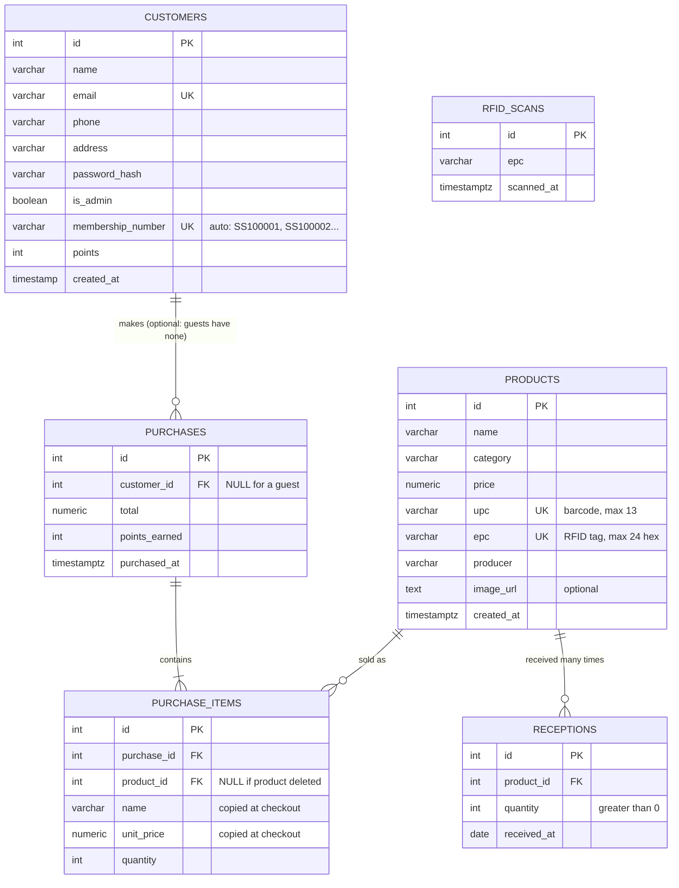

# SuperStore — Phase 3 ER Diagram

GitHub renders this diagram automatically. The full SQL is in `config/db.sql`.

## Design decisions

| Decision | Why |
|---|---|
| **Product 1 — N Reception** | The spec says a product is defined once but received many times. Each delivery is one row with its own quantity and date. |
| **Stock is computed, not stored** | The `product_stock` view = everything received − everything sold. A stored `stock` column could drift out of sync; a computed one can't. |
| **UPC and EPC are `UNIQUE`** | A scan must point to exactly one product. At least one of the two is required (`CHECK`). |
| **Purchase items copy name and price** | A receipt from last month must still show what the customer paid, even after the product is renamed, repriced or deleted. |
| **`ON DELETE CASCADE` on receptions, `SET NULL` on purchase items** | Deleting a product removes its delivery history, but never removes anyone's receipt. |
| **`customer_id` nullable on purchases** | A customer can check out without a membership card (no points, no email). |
| **`rfid_scans` table** | The RFID reader is plugged into the Pi, not the browser. `rfid.py` writes each tag here; the product form and checkout page poll for new ones. |
| **`is_admin` on customers** | Admins and customers share one login; only admins reach the management pages. Set it in Supabase, never from a form. |
